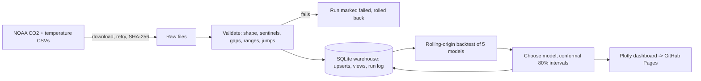

# Climate Forecast Pipeline

**A monthly data pipeline for NOAA's atmospheric CO2 and global temperature records: download, validate, load into a SQL warehouse, backtest five forecasting models, and publish a dashboard, automatically every month.**


Live dashboard: `https://Dhruvsanghavi07.github.io/climate-forecast-pipeline/` (refreshed on the 12th of each month by GitHub Actions)

## Results (data through September 2026)

Rolling-origin backtest: 40 forecast origins every 3 months from 2014 to 2024, each model seeing only data up to its origin.

| Model | MAE, 1-12 months ahead (ppm) | MAE, 13-24 months ahead (ppm) | Skill vs seasonal naive |
|---|---|---|---|
| Seasonal naive + drift | 0.558 | 0.822 | 78.7% |
| **Quadratic trend + Fourier seasonality (chosen)** | **0.559** | **0.614** | **78.6%** |
| Growth model, Ridge | 0.641 | 1.363 | 75.5% |
| Growth model, gradient boosting | 0.702 | 1.299 | 73.2% |
| Seasonal naive (baseline) | 2.615 | 5.189 | 0% |

- The pipeline picks the model with the lowest error over all 24 horizons: the trend + Fourier model, which holds up best at 13-24 months.
- **80% prediction intervals covered 85% of held-out errors** (quantiles estimated on 2014-2019 origins, checked on 2019-2024).
- Over 1959-2025, annual temperature anomaly vs ln(CO2) gives **2.76 °C of warming per doubling of CO2 (r² = 0.93)**. This is a correlation over the observed record that folds in other forcings, not a causal climate-sensitivity estimate.
- Full run (download, validate, load, 200 backtest fits, report): about 9 seconds on a laptop.

## Pipeline



| Stage | File | What it does |
|---|---|---|
| Extract | `climate/sources.py` | Downloads each CSV with retries and exponential backoff; stores the SHA-256 and fetch time next to it. |
| Validate | `climate/validate.py` | Checks row shape, duplicate and missing months, ordering, physical ranges and implausible jumps; converts NOAA sentinel values (-99.99, -9.99) to missing. Fatal checks stop the run; warnings are reported. |
| Load | `climate/warehouse.py`, `climate/schema.sql` | SQLite with `CHECK` constraints, idempotent `INSERT ... ON CONFLICT DO UPDATE` upserts, a `pipeline_runs` audit table, and SQL views for annual means, year-over-year growth (`LAG` window function) and the CO2-temperature join. A failed run rolls back and is logged as failed. |
| Model | `climate/forecast.py` | Five models, rolling-origin backtest with per-horizon errors, model selection, split-conformal intervals. |
| Report | `climate/report.py` | One HTML page: forecast with interval band, error by horizon, yearly growth, CO2 vs temperature, data-check results. |
| Schedule | `.github/workflows/refresh.yml` | Runs monthly and deploys the dashboard to GitHub Pages. |

## A data-quality bug this catches

The CO2 file's header names 6 columns, but every row has 7, and the header labels don't match what the columns hold. Reading it with `pd.read_csv` defaults silently mislabels every column after the monthly average: the "Number of Days" column ends up holding standard deviations. The validator checks the row width against the schema and assigns columns by position, and a test fails if day counts ever fall outside 0-31.

## Run it

```bash
python -m venv .venv && source .venv/bin/activate
pip install -e ".[dev]"
climate-pipeline                 # downloads, then writes data/warehouse.db and site/index.html
open site/index.html             # or start a server: python -m http.server -d site
pytest -q                        # 21 tests, about 20 seconds
```

Query the warehouse directly:
```bash
sqlite3 data/warehouse.db "SELECT * FROM co2_annual_growth ORDER BY year DESC LIMIT 5;"
sqlite3 data/warehouse.db "SELECT run_id, status, rows_upserted FROM pipeline_runs;"
```

To publish the dashboard: in the repository settings, set **Pages → Source** to **GitHub Actions**, then run the **Monthly refresh** workflow once from the Actions tab.

## Models

- **Seasonal naive:** the same month last year. The baseline every other model has to beat.
- **Seasonal naive + drift:** same month last year plus the average yearly rise over the last 5 years.
- **Trend + Fourier:** Ridge regression on a quadratic time trend and three pairs of annual sine/cosine terms, fit to the last 20 years.
- **Growth models:** forecast the 12-month increase from its last 12 values (Ridge or histogram gradient boosting), recursively, then add it to the value 12 months earlier. Trees cannot extrapolate a rising level, but the growth rate stays in a narrow range, so they can model it.

Prediction intervals are split-conformal: the 80th percentile of absolute backtest error at each horizon, added on both sides of the forecast.

## Tests

`pytest -q` runs 21 tests on real data fixtures and synthetic series:
- validation: shape mismatch, sentinels, duplicates, gaps, ranges, jumps
- warehouse: idempotent upserts, rollback and logging of a failed run, `CHECK` constraints, SQL views, gap interpolation
- forecasting: models recover a known trend and season, **no look-ahead in the backtest** (a spy model records what data it was given), models beat the naive baseline, interval shape, and the warming regression on a series with a known answer
- end to end: a full offline run writes the warehouse, dashboard and summary, and a second run is a new run on the same data

## Data and license

Code: MIT. Data: NOAA Global Monitoring Laboratory (Mauna Loa CO2) and NOAA global temperature anomalies (relative to the 1901-2000 average), via the public-domain mirrors at github.com/datasets/co2-ppm and github.com/datasets/global-temp.
